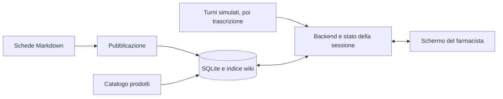

# Sales Agents — piano dell’applicazione

Bozza di progettazione del 7 novembre 2026. I requisiti e le decisioni correnti sono nel [TaskState](TaskState.md). Le domande ancora aperte sono nella [discovery](DISCOVERY.md). La sequenza della prima prova è già descritta nella [specifica del dialogo](superpowers/specs/2026-11-07-prova-al-banco-design.md).

> Stato aggiornato: questo documento conserva la proposta iniziale. Il prompt successivo ha scelto l’ascolto Vosk locale in tempo reale e il farmacista conferma manualmente il prodotto; il prototipo attuale usa Python stdlib, HTML/CSS/JavaScript e SQLite. Per interfacce, verifiche e limiti correnti vedere [contratto sessione](CONTRATTO_SESSIONE.md), [TaskState](TaskState.md) e [guida al banco](../frontend/README.md). Le fasi di dialogo simulato e Flask descritte sotto non rappresentano lo stato implementato.

## Il flusso al banco

Il farmacista usa uno schermo con tre aree: contesto della consultazione, prodotto attivo e contenuto utile della wiki. Può cercare manualmente un prodotto o un argomento in qualsiasi momento. Durante il dialogo il sistema usa il contesto per trovare contenuti pertinenti. Quando il prodotto passa allo stato «Consigliato», la scheda rimane visibile e il riquadro accanto mostra il passo successivo previsto dalla regola. Il modo in cui si conferma il consiglio è ancora da concordare.

La prima prova riproduce una conversazione a turni con il [catalogo sintetico già disponibile](../demo/README.md). Una menzione di un prodotto già usato apre il contesto. L’apertura di una scheda permette la consultazione. La conferma cambia il promemoria. Una correzione sostituisce il prodotto, cancella il precedente stato di conferma e aggiorna disponibilità e contenuto.

## Wiki e catalogo

**Scelta confermata.** Chi cura il progetto modifica schede in Markdown. I contenuti clinici reali passano dalla verifica di un farmacista prima di comparire al banco.

Proposta di struttura. Una pagina per prodotto e pagine trasversali per argomento, domande da approfondire e promemoria. Ogni pagina ha ID stabile, titolo, tipo, parole chiave, breve sintesi e testo. Una pagina prodotto contiene il codice del catalogo. Per contenuti reali si aggiungono fonte, data, versione e revisione. Gli esempi sintetici hanno lo stato `demo`, mentre le pagine reali entrano nell’indice del banco dopo la pubblicazione.

| Dato | Fonte proposta | Utilizzo sullo schermo |
|---|---|---|
| Nome, codice, categoria, formato, immagine, prezzo e scorte | Catalogo SQLite nella prova. In seguito import o gestionale quando noto | Scheda del prodotto e stato commerciale |
| Sintesi, dettagli, fonte e data di verifica | Schede Markdown pubblicate | Consultazione con collegamento alla fonte |
| Quando mostrare un promemoria o una scheda successiva | Regole distinte dalle pagine, versionate e revisionabili | Scelta del contenuto collegata al contesto e alla fase |

Il passaggio Markdown → SQLite è una pubblicazione esplicita. Il backend valida gli ID, i riferimenti al catalogo e lo stato delle pagine, poi aggiorna dati e indice FTS5 insieme. Un import non valido lascia utilizzabile la versione precedente. La prova mantiene il catalogo SQL come riferimento per i dati sintetici esistenti. Quando le pagine passano a Markdown, l’indice diventa una copia ricostruibile e la modifica del testo avviene in un solo posto. Il catalogo commerciale ha una fonte separata. [Documentazione SQLite FTS5](https://www.sqlite.org/fts5.html)

Per una scheda di un medicinale autorizzato in Italia, il curatore può collegare il riassunto delle caratteristiche del prodotto e il foglio illustrativo al prodotto e alla confezione verificati. Per gli integratori si usa la documentazione verificata del prodotto pertinente. Le pagine e le trascrizioni entrano nel sistema come dati da mostrare o cercare. [Riferimento AIFA](https://www.aifa.gov.it/riassunto-caratteristiche-e-foglio-illustrativo)

## Struttura delle cartelle

La struttura concordata prevede quattro cartelle alla radice del progetto.

| Cartella | Responsabilità |
|---|---|
| `frontend/` | Schermata del farmacista, componenti visivi, stili e interazioni con il backend. |
| `backend/` | Server, ricerca, stato della consultazione, regole e procedura di pubblicazione della wiki. |
| `database/` | Schema SQLite, dati di prova, migrazioni e copie ricostruibili del database e dell’indice. |
| `wiki/` | Schede Markdown e metadati editoriali, con fonti e stato di revisione. |

Il backend legge le schede da `wiki/` durante la pubblicazione e aggiorna l’indice in `database/`. Il frontend riceve i risultati dal backend. Le quattro cartelle organizzano una sola applicazione locale.

## Backend e interfaccia

**Proposta tecnica.** Una sola applicazione web sul PC, con un backend Python e Flask, SQLite e una schermata in HTML, CSS e JavaScript. La demo gira su indirizzo locale. Il backend serve sia la pagina sia i dati, con un unico comando di avvio. Un eventuale uso stabile al banco richiede un avvio adatto a quell’ambiente. [Flask Quickstart](https://flask.palletsprojects.com/en/stable/quickstart/), [Flask Deployment](https://flask.palletsprojects.com/en/stable/deploying/)

Il backend governa ricerca, sessione e regole. La schermata chiede risultati e invia azioni. Il dialogo simulato e, in seguito, la trascrizione alimentano lo stesso flusso con eventi strutturati. L’adattatore audio si progetta quando ne conosciamo origine e vincoli.

| Interfaccia proposta | Cosa deve garantire |
|---|---|
| Ricerca e apertura scheda | Codice esatto prima della ricerca per nome e parole chiave. Un risultato distingue prodotto e pagina trasversale e porta ID, sintesi e fonte. Zero corrispondenze produce uno stato vuoto. |
| Stato della consultazione | Identificativo e revisione di sessione, fase, contesto, prodotto attivo, stato della scelta, contenuto pertinente e motivo della sua selezione. |
| Applicazione di un’azione | Avanza, apri, conferma, correggi e ricomincia producono uno stato aggiornato. Una richiesta ripetuta o superata non deve avanzare due volte né riportare sullo schermo lo stato della sessione precedente. |
| Regole di visualizzazione | Dato un evento, il contesto e una versione delle regole, restituiscono il contenuto collegato con la motivazione oppure un dato da verificare. Una frase ambigua lascia la scheda consultabile e sospende il passaggio a un nuovo consiglio. |

## Frontend

- Barra superiore con ricerca, fase della consultazione e comando per una nuova sessione.
- Area prodotto con grafica del formato o immagine disponibile, nome, categoria, prezzo, stock e indicazione chiara quando è esaurito.
- Area wiki con sintesi, motivo per cui è aperta, fonte e accesso al dettaglio.
- Nella demo, controlli `Avanti` e `Ricomincia` e indicazione del turno. Durante una consultazione manuale, un comando permette di tornare al contenuto del dialogo. Le nuove risposte devono rispettare l’ultima ricerca o azione dell’utente.
- Stati leggibili per ricerca vuota, scheda mancante, dato da verificare e interruzione del collegamento. Il reset ripulisce selezione e promemoria della sessione chiusa.

## Ordine di sviluppo

| Fase | Consegna | Evidenza richiesta |
|---|---|---|
| 1. Prova locale | Catalogo e wiki, ricerca manuale, pagina e dialogo simulato | «Raffreddore» ritrova la pagina di prova e `DEMO-OTC-02` il prodotto esatto. I quattro turni, lo zero a magazzino e il reset funzionano nel browser. |
| 2. Contenuti curati | Flusso di revisione e pubblicazione Markdown. Primo catalogo reale solo quando fonte e modalità di import sono note | Le pagine cliniche in bozza restano fuori dalla ricerca al banco. Per decisione dell’utente, le relazioni candidate sintomo-prodotto con indicazione e fonte ufficiale esplicite possono comparire nella postazione del farmacista come riferimenti non revisionati, senza ordinamento o linguaggio di consiglio. Una scheda mostra fonte, versione e stato di revisione. |
| 3. Audio | Ingresso audio e trascrizione per prove controllate. Una volta scelto il funzionamento, si collegano gli eventi alla schermata | I casi con menzioni, negazioni, correzioni e parlante incerto producono esiti distinti. Si misurano tempo di aggiornamento ed errori su dialoghi di prova. Il pilot con clienti richiede decisioni specifiche sull’uso dei dati. |
| 4. Feedback e miglioramento | Il farmacista segnala se una scheda è utile o va corretta. I casi diventano esempi per confrontare regole e modifiche candidate | Una proposta ha motivo, casi e versione. Le modifiche con effetto sui consigli entrano in uso dopo revisione del farmacista e la versione precedente resta recuperabile. |

Nelle prime fasi usiamo regole esplicite con condizioni, fonte e versione. Prezzo e scorte informano la consultazione commerciale. Per contenuti con effetto sui consigli, le condizioni verificate vengono prima di qualunque ordinamento commerciale. L’audio incerto e i dati mancanti devono portare alla verifica del farmacista. Il feedback serve a migliorare selezione e chiarezza, con esempi separati per controllare le modifiche.

## Decisioni da chiudere prima del prompt definitivo

Il punto di conferma del consiglio determina il passaggio alla scheda successiva. La modalità di avvio dell’ascolto determina controlli, stato del microfono e perimetro della sessione. I dettagli sulla trascrizione, sui dati reali e sui feedback dipendono da queste scelte e sono rinviati ai prossimi round di [grilling](DISCOVERY.md). La [bozza del prompt](PROMPT_IMPLEMENTAZIONE.md) segue le fasi di questo piano.
